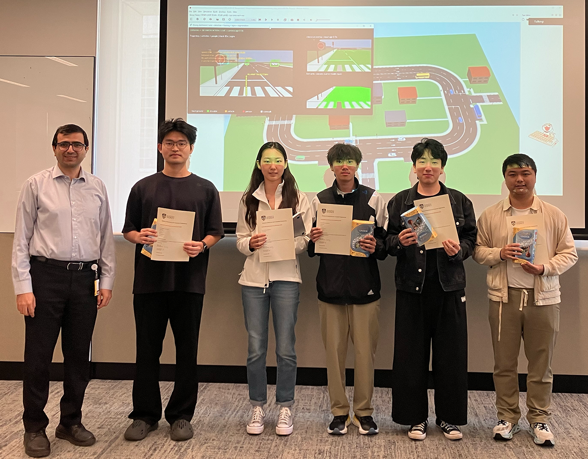

# ELEC5308 Hall of Fame

Celebrating outstanding student teams from **ELEC5308: Intelligent Information Engineering Practice** at the University of Sydney.

## 2026 Autonomous Driving Showcase

> **Showcase date:** 5 November 2026  
> **Course:** ELEC5308  
> **Theme:** Autonomous Driving Cars

The 2026 showcase brought together student teams to demonstrate autonomous vehicles developed using simulation and autonomous-system platforms.

<!-- Optional banner image -->
./images/2026/showcase-banner.jpg

---

## 🥇 First Place

  

### Team Happy

**Team members**

- Dai, Chenbo
- Li, Elaine
- Xu, Hengfei
- Xue, Zhaolong
- Yan, Hezhong

**Platform:** Webots
**Deme:** [Youtube](https://youtu.be/PX0Hu-Crd40)

---

## 🥈 Second Place

  

### Group 3

**Team members**

- Chen, Qize
- Shi, Mingcheng
- Zhao, Yinbo
- Dinh Quang Huynh
- Zhou, Busen

**Platform:** Webots

---

## 🥉 Third Place

  

### Group 5

**Team members**

- Gong, Wenqian
- Haider, Marium
- Li, Shengwei
- Nguyen, Amy
- Somayaji, Ananth Rahul

**Platform:** Webots

---

## ⭐ People’s Choice Award

  

### Group 14

**Team members**

- Fang, Leo
- Huang, Man Ching
- Li, Mingze
- Lu, Liwei
- Tanoyo, Matthew

**Platform:** Webots

---

## Showcase Judges

We sincerely thank the judging panel for contributing their time, expertise, and thoughtful feedback.

- [Associate Professor Dong Yuan](https://profiles.sydney.edu.au/dong.yuan), School of Electrical and Computer Engineering
- [Associate Professor Luping Zhou](https://profiles.sydney.edu.au/luping.zhou), School of Electrical and Computer Engineering
- [Dr Shahadat Uddin](https://profiles.sydney.edu.au/shahadat.uddin), School of Electrical and Computer Engineering
- [Dr Wei Li](https://profiles.sydney.edu.au/weiwilson.li), School of Electrical and Computer Engineering

---

## ELEC5308 Teaching Team

The showcase and the students’ work were supported by the 2026 ELEC5308 teaching team:

- [**Dr Ali Shakiba**](https://ashakiba.com), Unit Coordinator
- [**Hyeonggeun Yun**](https://hyeonggeunyun.com/), Teaching Team
- [**Niki Frampton**](https://www.researchgate.net/profile/Niki-Frampton), Teaching Team
- [**Yeming Chen**](https://www.linkedin.com/in/yeming-chen-320b461b1/), Teaching Team

---

## About the Awards

The showcase awards recognise achievement across autonomous-system performance, engineering quality, safety, technical communication, and the teams' ability to explain and defend their design decisions.

| Award | Recognition |
|---|---|
| First Place | Certificate of achievement, team prizes, and 5 bonus marks |
| Second Place | Certificate of achievement and 3 bonus marks |
| Third Place | Certificate of achievement and 2 bonus marks |
| People’s Choice | Certificate of achievement, prizes, and Hall of Fame recognition |

The People's Choice Award is presented to the highest-ranked eligible team that did not receive one of the three judges’ awards.

---

## Congratulations

Congratulations to all ELEC5308 students who designed, integrated, tested, and demonstrated their autonomous systems.

The Hall of Fame recognises the award recipients, but the showcase celebrates the engineering judgement, teamwork, persistence, and creativity demonstrated by the entire cohort.
